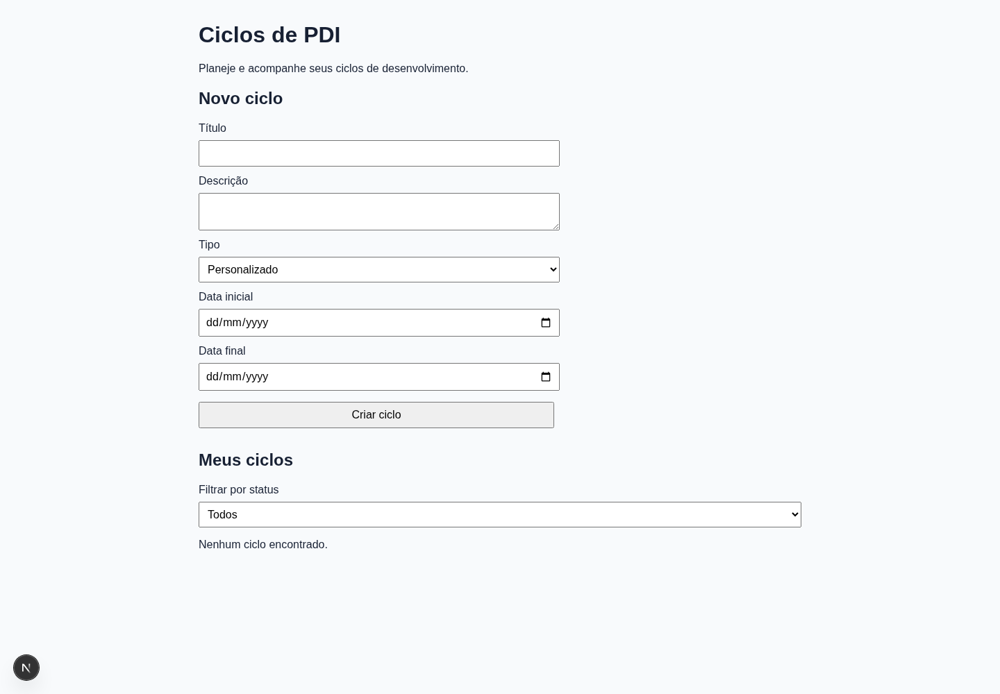
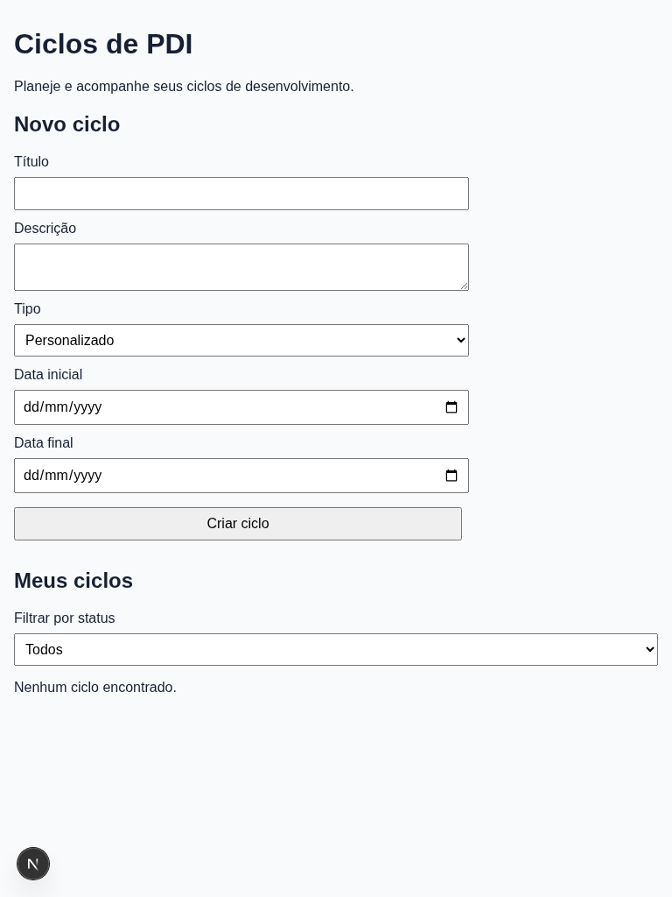
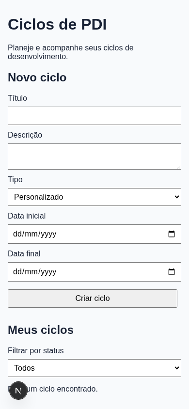

# Diagnóstico inicial — PDI Web

**Data**: 2026-11-06. **Finalidade**: fundamentar a SPEC-002 antes de elaborar requisitos, sem implementar mudanças.

## Método e inventário

Inspeção de código, rotas, estilos e testes, seguida de navegação local com Playwright 1.57.0/Chromium 143, contexto isolado e dados sintéticos criados pelo formulário. A ferramenta foi instalada no cache, sem alterar dependências do projeto ou dados do navegador pessoal. Capturas principais: desktop 1440×1000, tablet 768×1024, mobile 390×844, idioma pt-BR e fuso America/Sao_Paulo. Medições adicionais: larguras 320, 360, 1024 e 1280. [Registro detalhado](evidence/observations.json).

Screenshots são full-page: podem superar a largura da viewport quando há overflow; isso é a falha observada. O servidor estava em desenvolvimento. O indicador “N” pertence ao ambiente e não foi atribuído ao design do produto. Não se criaram baselines de aceitação.

| Fonte inspecionada | Resultado |
| --- | --- |
| [Entrada](../../apps/web/src/app/page.tsx) e [rota](../../apps/web/src/app/pdi-cycles/page.tsx) | `/` redireciona para `/pdi-cycles`; cadastro, lista, filtro e transições na mesma superfície. |
| [Interface](../../apps/web/src/features/pdi-cycles/components/cycle-dashboard.tsx) | Cinco campos, lista textual, botões iniciar/concluir/cancelar conforme estado, carregamento e erro global. |
| [Estilos](../../apps/web/src/app/globals.css) e [layout](../../apps/web/src/app/layout.tsx) | Estilização mínima, sans-serif, foco visível; limites de conteúdo/formulário de 900/520 pixels e espaçamentos locais. |
| [Manifesto](../../apps/web/package.json) | Next.js, React, TypeScript confirmados; Tailwind, shadcn/ui ou biblioteca visual reutilizável configurada não encontrados nesta árvore, embora mencionados no pedido. |
| [Domínio](../../apps/web/src/features/pdi-cycles/domain.ts) e [adaptador](../../apps/web/src/features/pdi-cycles/adapters/local-storage-pdi-cycle-repository.ts) | Regras separadas da apresentação; armazenamento local; operações de consulta/edição sem todos os controles correspondentes na interface. |
| [Testes](../../apps/web/src/features/pdi-cycles/tests/domain.test.ts) | `pnpm test`: quatro testes passaram. Nenhuma configuração/suíte E2E ou de screenshots identificada. O roteiro desta auditoria não é uma suíte de regressão instalada. |

Não foram encontradas telas de detalhe, edição ou histórico, paginação visível, autenticação completa ou dashboard analítico. São divergências preexistentes frente à SPEC-001, a tratar no trabalho funcional correspondente; não serão criadas neste refinamento.

## Passos e capturas

Todas as imagens foram salvas e abertas para inspeção antes de serem usadas como evidência. “Funciona” descreve somente o roteiro observado.

| Passo | Ação/evidência | Saúde observada |
| --- | --- | --- |
| 01 | [Entrada e vazio desktop](evidence/01-desktop-empty.png) | Funciona; propósito claro, controles genéricos, formulário dominante. |
| 02 | [Vazio tablet](evidence/02-tablet-empty.png) | Funciona; formulário/filtro têm larguras distintas sem composição explícita. |
| 03 | [Vazio mobile](evidence/03-mobile-empty.png) | Utilizável no vazio; formulário e filtro empilhados, vazio perto do fim da primeira tela. |
| 04 | [Criar e iniciar](evidence/04-desktop-active.png) | Funciona; ACTIVE com concluir/cancelar; sucesso comunicado apenas pela lista atualizada. |
| 05 | [Tentar segundo ativo](evidence/05-desktop-business-error.png) | Regra preservada; erro distante da ação e com código inglês. |
| 06 | [Concluir, cancelar e título limite desktop](evidence/06-desktop-mixed.png) | Transições funcionam; título válido sem espaços provoca overflow. |
| 07 | [Lista mista tablet](evidence/07-tablet-mixed.png) | Overflow; status/datas pouco diferenciados visualmente. |
| 08 | [Lista mista mobile](evidence/08-mobile-long-title.png) | Falha de largura: página cresce para 1443 pixels. |
| 09 | [Filtro sem resultados](evidence/09-desktop-filter-empty.png) | Funciona; mensagem igual à primeira utilização. |
| 10 | [Datas iguais mobile](evidence/10-mobile-date-error.png) | Recusa correta, valores mantidos; erro antes do formulário, sem associação ao campo. |
| 11 | [Foco e travessia parcial](evidence/11-mobile-focus.png) | Foco de 3 pixels observado; amostra de Tab não comprova navegação completa. |
| 12 | [Falha de leitura simulada](evidence/12-mobile-storage-error.png) | Erro técnico inglês e “Nenhum ciclo encontrado” coexistem; estado ambíguo. |

### Aparência atual

As outras imagens estão vinculadas aos passos. Nenhuma prescreve a nova estética.

## Achados objetivos e oportunidades

Prioridade alta: impede leitura/ação ou informa estado incorreto. Média: dificulta entendimento, recuperação ou consistência. Baixa: oportunidade visual sujeita a validação humana.

| ID | Prioridade/tipo | Evidência observada | Implicação |
| --- | --- | --- | --- |
| D-01 | Alta · responsividade | Título válido com 120 letras “D” sem espaços excede todas as sete larguras. Passos 06–08. | Exigir quebra de texto sem mudar limite de dados ou esconder overflow. |
| D-02 | Média · linguagem | DRAFT/ACTIVE/COMPLETED/CANCELLED no filtro/lista; datas da lista em formato `2026-11-01`, diferentes da apresentação local dos campos. | Português consistente e datas compreensíveis sem mudar valores. |
| D-03 | Média · formulário | Erro de datas acima de “Novo ciclo”; sem mensagem associada ou indicação própria de inválido no código. Passo 10. | Erro junto ao campo, associação assistiva, orientação de foco e valores preservados. |
| D-04 | Média · resultado | Erro de segundo ativo no topo, longe da ação; ausência de confirmação textual explícita de sucesso. Passos 04–05. | Feedback contextual e anunciado, preservando regras. |
| D-05 | Alta · falha | Armazenamento inválido isolado gera erro técnico inglês e mensagem de vazio. Passo 12. | Distinguir erro/vazio e orientar em português, sem alterar formato ou persistência neste escopo. |
| D-06 | Média · vazio | Mesma mensagem no primeiro uso e no filtro vazio. Passos 01 e 09. | Explicar contexto e apontar ao formulário/seletor existentes. |
| D-07 | Média · ações | Iniciar/concluir/cancelar usam o mesmo botão nativo. Passos 04–08. | Papéis/variantes claros; cor exata depende de aprovação estética. |
| D-08 | Média · padrões | Controles nativos; criar termina 8 pixels antes da borda dos campos por margem global; formulário limitado a 520 pixels e filtro ocupa região toda. | Documentar alinhamentos, espaçamento, tipos de controle e composição por largura. |
| D-09 | Média · toque adicional | Em 390 pixels, criar/iniciar/cancelar têm 38 pixels de altura; seletores, 37. | Exigir 44 pixels em ações mobile como requisito de produto. Isso não comprova violação do mínimo AA de 24 pixels. |
| D-10 | Média · organização | Lista vem após todo o formulário, perto da base da primeira tela mobile; espaço à direita do formulário desktop fica vazio. | Rever prioridades com referências; não é falha funcional comprovada nem obrigação de adicionar colunas/barra lateral. |
| D-11 | Média · estados, código | Há carregamento de consulta, sem estado explícito de envio/transição ou desabilitado pendente. Carregamento não foi capturado estável com adaptador rápido. | Especificar esses estados. Submissão repetida indevida não foi reproduzida e não é bug comprovado. |
| D-12 | Baixa · estética humana | Títulos padrão, controles cinza e lista com marcadores, sem identidade visual diferenciada. | Propor hierarquia e identidade de produto; simplicidade atual é base aproveitável, sem reconstrução. |

### Medições de largura

| Viewport CSS | Largura rolável no vazio | Com título válido sem espaços | Resultado do título |
| --- | --- | --- | --- |
| 320 | 320 | 1443 | Falha |
| 360 | 360 | 1443 | Falha |
| 390 | 390 | 1443 | Falha |
| 768 | 768 | 1443 | Falha |
| 1024 | 1024 | 1505 | Falha |
| 1280 | 1280 | 1633 | Falha |
| 1440 | 1440 | 1713 | Falha |

O vazio passa nas larguras medidas; o conteúdo no limite demonstra por que capturas apenas vazias são insuficientes.

## O que preservar

- Título/descrição explicam propósito; ordem de campos simples e rótulos associados.
- Regiões tituladas semanticamente, página pt-BR, estrutura com anúncio de erro e carregamento.
- Foco visível existente. Não foram observados gradientes, sombras exageradas, excesso de decoração ou grade repetitiva de cards; são limites futuros do pedido, não defeitos atribuídos sem evidência.
- Cadastro, filtro, início, conclusão, cancelamento e bloqueio de segundo ativo funcionaram no roteiro. Encerrados permanecem listados sem ações mutáveis.
- Datas inválidas são recusadas e valores mantidos; formulário limpo após sucesso.
- Regras separadas da apresentação permitem evolução incremental.

## Limites da análise

Não houve avaliação WCAG completa, leitor de tela, medição de todos os contrastes, aparelho físico/teclado virtual, zoom real 400%, navegação integral apenas por teclado ou inspeção de todos os estados nativos. São verificações da entrega futura, não resultados desta auditoria.

A amostra de foco contém oito posições. Segmentos nativos de data podem manter o mesmo elemento ativo; repetição não prova armadilha. Screenshots não comprovam conformidade completa. Não se obteve captura estável de carregamento; indisponibilidade/microinterações não foram observadas como estados distintos. Verificar futuramente com latência controlada, sem introduzir atraso no produto.

Quatro testes de domínio passaram; ausência de suíte E2E não permite afirmar ausência de regressões E2E. O roteiro temporário exercitou caminhos reais, sem instalar uma suíte. Contrato e regras permaneceram intocados. Não se validou backend, autenticação, concorrência entre abas ou operações ausentes da interface.

O diagnóstico fundamenta layout, clareza e estados; paleta, tipografia final, composição e sobriedade continuam escolhas humanas, separadas dos requisitos objetivos na [SPEC-002](spec.md).
