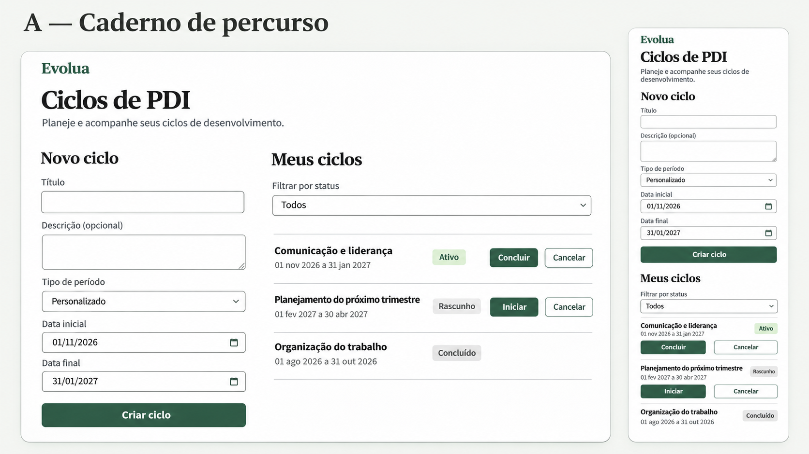
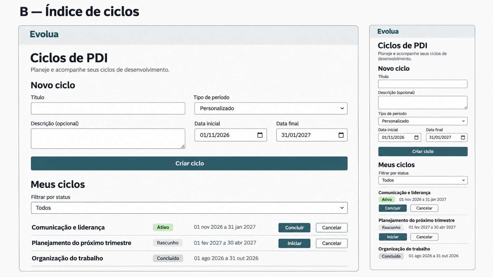
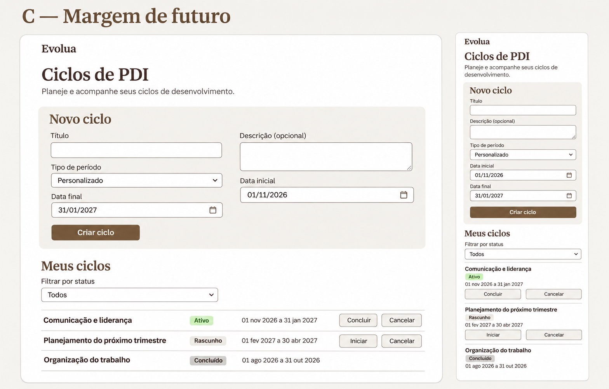

# Direções de arte — decisão de planejamento

**Data**: 2026-11-06. As três prévias foram apresentadas antes da consolidação. O usuário respondeu **“A”**, selecionando **Caderno de percurso**. A decisão aprova a direção; não aprova implicitamente medidas, todos os estados, a implementação ou baselines.

## Brief comum

Produto: acompanhamento individual de ciclos de desenvolvimento profissional. A página ajuda a planejar períodos, reconhecer o ciclo ativo e consultar ciclos encerrados. O conteúdo real é o ponto de partida, sem hero de marketing, estatísticas inventadas, nova navegação, fotografias ou decoração de produtividade.

Todas as propostas preservam os cinco campos, filtro e transições existentes. Alinhamento à esquerda, textos em sentence case, corpo de 16 pixels, sem palavras isoladas coloridas no título, labels em caixa alta ou números ornamentais. Estrutura expressa relações reais, sem imitar um jornal denso.

## Comparação das três propostas

| Direção | Base de cor (seis valores) | Tipografia e caráter | Composição | Trade-offs |
| --- | --- | --- | --- | --- |
| **A — Caderno de percurso, escolhida** | Pérola `#F6F7F4`, papel `#FFFFFF`, grafite `#252A27`, texto auxiliar `#5D6761`, verde `#31584A`, borda `#7B857E` | Newsreader nos títulos; Source Sans 3 na interface. Editorial contemporâneo, pessoal e sóbrio. | Formulário à esquerda e lista à direita em desktop; empilhamento na mesma ordem em tablet/mobile. | Melhor equilíbrio entre identidade e operação; duas famílias exigem fontes locais e calibração; colunas precisam recolher cedo para preservar formulários e ações. |
| **B — Índice de ciclos** | Branco `#FCFCFA`, névoa `#EFF1F2`, tinta `#252D31`, auxiliar `#59656D`, petróleo `#315764`, borda `#7B858A` | IBM Plex Sans, com pesos intencionais. Caráter de catálogo claro e técnico. | Formulário horizontal acima de lista alinhada em faixas; sem cartões. | Menor custo tipográfico e leitura operacional forte; menos expressividade pessoal, formulário largo pode afastar consulta. |
| **C — Margem de futuro** | Mineral `#F7F6F2`, branco `#FFFFFF`, tinta `#35312D`, auxiliar `#68615B`, umbra `#65543E`, borda `#8A8277` | Literata nos títulos e Public Sans na interface. Leitura calma e humana. | Coluna ampla, formulário sobre faixa mineral e lista abaixo. | Acolhedora e espaçosa; maior altura até os ciclos e risco de parecer publicação de conteúdo em vez de ferramenta. |

### A — Caderno de percurso



```text
Desktop                         Tablet / mobile
Evolua                          Evolua
Ciclos de PDI                   Ciclos de PDI
Introdução                      Introdução
Novo ciclo  | Meus ciclos        Novo ciclo
Formulário  | Filtro             Formulário
Criar ciclo | Itens e ações      Criar ciclo
            |                   Meus ciclos
                                Filtro, itens e ações
```

### B — Índice de ciclos



```text
Desktop                         Mobile
Título e introdução             Título e introdução
Formulário em duas colunas       Formulário empilhado
Criar ciclo                     Criar ciclo
Filtro                          Filtro
Lista com colunas de leitura     Lista com itens empilhados
```

### C — Margem de futuro



```text
Desktop e mobile
Título e introdução
Faixa mineral: formulário
Criar ciclo
Meus ciclos, filtro
Itens com mais espaço vertical
```

## Segunda passagem crítica e consolidação de A

Foi descartado o caminho automático de fundo creme com terracota e serifada de alto contraste: o produto exige clareza operacional, não aparência de blog. Também foram descartadas barra lateral, cartões uniformes, ícones de crescimento e barras percentuais sem dados. O gesto memorável de A será a tipografia dos títulos; os controles ficam discretos.

A prévia A exagera o peso dos títulos, comprime controles no mobile e deixa diferenças de tamanho que uma imagem não consegue medir. O plano consolida Newsreader 400/500, corpo Source Sans 3 400/600, alvos de 44 pixels e critérios explícitos de reflow. No mobile, datas ficam empilhadas; no desktop, somente se a largura interna comportar dois campos. Ações podem ir à linha seguinte, sem forçar títulos a caber numa coluna estreita. O catálogo técnico, e não pixels inferidos da imagem, governa esses detalhes.

As prévias têm três ciclos para comparação; a implementação também precisa contemplar CANCELLED, vazio, erro, foco, indisponível e limites longos. Esses estados ainda exigem referências detalhadas e aprovação. A borda arredondada ao redor de cada mockup é moldura da apresentação, não um card obrigatório da página.

## Produção e rastreabilidade

Ferramenta: `image_gen.imagegen` integrada, sem fallback CLI. Os screenshots atuais de desktop/mobile serviram apenas como referências de conteúdo. As três imagens originais foram copiadas sem edição para esta pasta; não serão importadas como assets da aplicação.

Prompts exatos: [prompts.json](prompts.json). Cores e pares calculados: [color-tokens.json](color-tokens.json), [contrast-report.json](contrast-report.json). As fontes nas imagens são aproximações geradas, não prova de carregamento das famílias escolhidas.

| Registro | Estado |
| --- | --- |
| Requisitos da SPEC-002 | Usuário declarou especificação aprovada ao solicitar planejamento |
| Comparação de A, B e C | Três prévias apresentadas nesta sessão |
| Direção escolhida | A; resposta explícita “A” do usuário, 2026-11-06 |
| Design system detalhado | Proposta técnica consolidada para A neste plano |
| Referências de todos os estados | A produzir/revisar antes do respectivo incremento visual |
| Baselines Playwright | Nenhum criado/atualizado nesta etapa |
